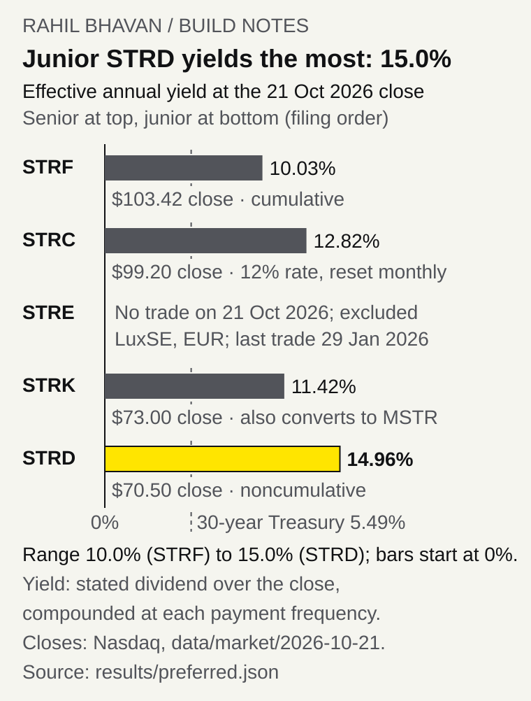

# Strategy credit comparison: five preferreds and six convertible-note scenarios

What Strategy's preferred shares pay at their real market prices, and what its convertible bonds are worth under stated assumptions.

[](https://github.com/RahilBhavan/strategy-credit-curve/actions/workflows/ci.yml) [](LICENSE)



An offline Python tool that sets Strategy's (formerly MicroStrategy, MSTR) five perpetual preferred stocks and six convertible notes side by side at one valuation date, October 21, 2026. Preferreds get effective yields at that day's Nasdaq close and spreads over a matching government benchmark. Notes get model values from a Tsiveriotis-Fernandes (TF) convertible-bond tree at the MSTR close, under an assumed volatility and credit-spread grid. It is a cross-instrument comparison, not a fitted credit term structure.

## Results

Preferreds at the October 21, 2026 close (`results/preferred.json`, table generated by `scripts/render_results.py`):

<!-- preferred-summary:start -->
| Preferred | Close 2026-10-21 | Effective yield | Benchmark | Spread (bp) |
|---|--:|--:|---|--:|
| STRF | $103.42 | 10.03% | UST 30y par 5.49% | 453 |
| STRC | $99.20 | 12.82% | UST 30y par 5.49% | 733 (882 vs SOFR) |
| STRE | no trade | excluded | ECB AAA euro-area 30y spot | not computed (last trade 2026-01-29) |
| STRK | $73.00 | 11.42% | UST 30y par 5.49% | 592; ex-option 703 (629 to 869) |
| STRD | $70.50 | 14.96% | UST 30y par 5.49% | 946 |

Valuation date 2026-10-21; benchmark rates: frozen public snapshot. Prices and the MSTR spot ($153.48) are Nasdaq daily closes (`data/market/2026-10-21/closes.json`). STRE is excluded. No 2026-10-21 trade: last STRE.LU bar with traded volume was 2026-01-29 at EUR 84.80 (5,200 shares); every later bar repeats that price on zero volume. STRK conversion price $1,000.00, parity $15.35 per $100 stated. "Ex-option" removes an assumed 10-year call value (range: 5 to 20 years, two assumed volatilities).
<!-- preferred-summary:end -->

- STRD, the most junior and the only noncumulative preferred, yields the most: 14.96% at a $70.50 close. STRF, the most senior, yields the least: 10.03% at $103.42.
- STRE is excluded. It trades only on the Luxembourg Stock Exchange in euros, and its last bar with traded volume is January 29, 2026 (`data/market/2026-10-21/closes.json`).
- Six notes × nine volatility/spread combinations = **54 model scenarios** (`results/convertibles.json`). At the $153.48 MSTR close and the central 60% volatility / 5% spread assumptions, values range from **$860.67 (2029) to $1,197.15 (2030A) per $1,000 face**. These are model values, not note quotes.
- **60 tests pass**. They cover source hashes and quotations, split-adjusted terms, independent analytic TF limits, convergence, coupon-date puts, offline CLI behavior, exchange-close provenance, portable inputs, user valuation dates and rates files, per-note assumptions and fetch retries.


## How it works

`scripts/fetch_closes.py` freezes the day's Nasdaq closes into `data/market/<date>/closes.json`. `inputs.py` validates that file and `rates.py` the optional rates file. `market.py` parses the bundled attributed government rates. `curve.py` compares preferreds, `notes.py` builds dated schedules, and `convertible.py` separates TF cash and equity discounting on a CRR tree. `run.py` writes both JSON outputs without network calls and `summary.py` prints the terminal table. `scripts/render_yields.py` and `scripts/render_results.py` draw the figures. Each output records the input kind and file hash; valuation, observation and retrieval dates stay separate.

## Run it

Tested with Python 3.13.15 and 3.14.7 and NumPy 2.5.4. No API keys or paid services are needed.

```bash
git clone https://github.com/RahilBhavan/strategy-credit-curve.git
cd strategy-credit-curve
python3 -m venv .venv
.venv/bin/python -m pip install -r requirements.txt
.venv/bin/python scripts/restore_data.py
.venv/bin/python -m unittest discover -s tests -v
.venv/bin/python -m credit_curve.run
.venv/bin/python scripts/render_results.py
```

Restoration rebuilds 34 public SEC source files and checks their hashes. The demo prints a summary table (preferred yields and spreads, MSTR spot, STRK and note conversion prices and parity, note values) and writes the preferred comparison and six nine-scenario note grids to `results/`. The figures and the README table are regenerated from those results. `--out <directory>` changes the output folder, and `--steps 1200` changes the default 600-step tree.

To freeze closes for another trading day, run `python scripts/fetch_closes.py YYYY-MM-DD` (network required; it calls Nasdaq and Yahoo Finance). To value your own prices, volatilities or a later date, copy the two files in [`data/scenarios/later-date/`](data/scenarios/later-date/), follow the [input contract](docs/market-inputs.md), and run:

```bash
python -m credit_curve.run --market-input data/scenarios/later-date/market-inputs.json \
  --rates data/scenarios/later-date/rates.json --out results/local
```

The later-date example files are synthetic and dated October 22, 2026. The market file sets `valuation_date` and quotes; its optional `note_assumptions` give an implied volatility and credit spread per note, valued alongside the unchanged 40/60/80% × 2/5/10% grid. The rates file supplies Treasury par yields, SOFR, the ECB 30-year AAA rate and EUR/USD for the same date, as decimals (4.5% is `0.045`). A date other than October 21, 2026 without `--rates` stops with an error that names the fix.

## Repository layout

- `credit_curve/`: source parsers, input validation, arithmetic and CLI.
- `data/`: public-source ledger, compressed SEC files, instrument terms, frozen exchange closes (`market/`) and labelled synthetic examples (`scenarios/`).
- `results/`: generated preferred comparison and note scenarios.
- `figures/`: generated yield chart, scenario table and their review briefs.
- `tests/`: numerical, source, input and workflow checks.
- `scripts/`: close fetching, public-source packing/restoration and figure generation.
- `docs/`: scope, methodology, source coverage, input contract and verification.

## Documentation

- [Public design system](DESIGN.md): Rahil Design 3.3.0, shared tokens and visual review rules.
- [Scope](docs/spec.md): accepted functionality and sanitized publication.
- [Methodology](docs/methodology.md): equations, assumptions and omitted features.
- [Sources](docs/sources.md): public provenance and the data-rights boundary.
- [Input diagnostics](docs/diagnostics.md): five-minute freshness and supplied-note comparison workflow.
- [Market inputs](docs/market-inputs.md): schema and local-input workflow.
- [Verification](docs/verification.md): checks and their limits.
- [Review](docs/review.md): demonstrated problems and repairs.
- [Publication receipt](docs/publication.md): remote and clean-clone evidence from the October 22 synthetic-input release.

## Sources

- Contract terms, split reconciliation and dated fair values come from [SEC filings](docs/sources.md). The public ledger `data/raw/manifest.csv` holds 67 attributed SEC, Treasury, NY Fed and ECB responses with original retrieval timestamps and SHA-256 hashes.
- Preferred and MSTR prices are October 21, 2026 daily closes from Nasdaq's historical-quote API, retrieved October 22, 2026 UTC and cross-checked to the cent against Yahoo Finance. `data/market/2026-10-21/closes.json` keeps each URL, retrieval time and response SHA-256. The closes are published; the vendor response bodies are not.
- Source: ECB statistics; rates/FX calculations are this project's transformations. The [ECB reuse policy](https://www.ecb.europa.eu/stats/ecb_statistics/governance_and_quality_framework/html/usage_policy.en.html) applies to its public statistics. See [sources](docs/sources.md) for ownership and provider exclusions.

## Scope and limits

- Independent research. Not affiliated with Strategy and not a trading recommendation.
- Prices are one day's closes, not live quotes. STRE has no trade on the valuation date and is excluded; the original private analysis used its November 6, 2025 €80 offering price, which is not substituted here.
- STRK option volatilities (60% and 80%) and the note volatility/spread grid are assumptions, not fitted or implied values. STRK's perpetual conversion right is approximated by finite European calls. Yield gaps do not isolate a noncumulative-dividend discount.
- Treasury par rates are proxies, not bootstrapped discount curves.
- Later valuation dates reuse the October 21 contract terms: STRC rate resets, new issuance, conversions and the October 28, 2026 daily-dividend vote (pending at the cutoff) are not applied.
- Note triggers use nodes rather than 20-of-30-day path tests. Make-whole tables, settlement elections, exact calendars/30-360 accrual, record-date ownership and TF default recovery are omitted. June 30 fair values are stale context.
- Analytic tests validate restricted limits, not full real-contract accuracy.

## License

[MIT](LICENSE). The license covers this project's code only. Third-party filings, statistics and market prices keep their own rights; no provider-data redistribution permission is claimed.

Part of [Rahil Bhavan's projects](https://github.com/RahilBhavan).
