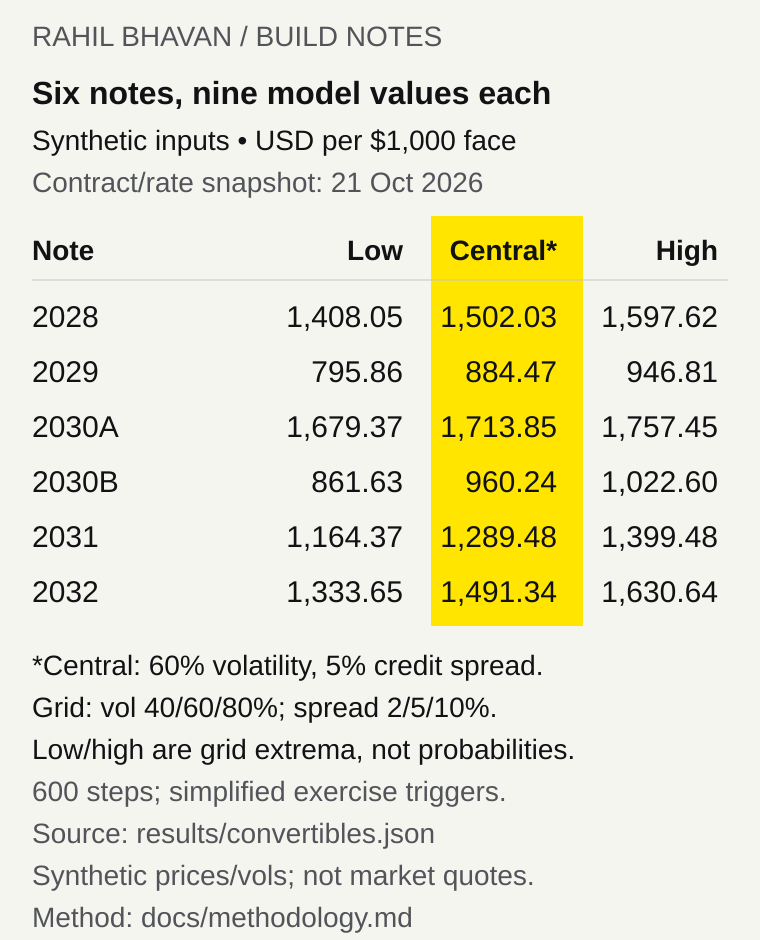

# Strategy credit comparison: five preferreds and six convertible-note scenarios

[](https://github.com/RahilBhavan/strategy-credit-curve/actions/workflows/ci.yml)



An offline Python tool that sets Strategy's (formerly MicroStrategy, MSTR) five perpetual preferred stocks and six convertible notes side by side at one valuation date. It is a cross-instrument comparison, not a fitted credit term structure: preferreds get effective yields and spreads over a matching government benchmark, and notes get model values from a Tsiveriotis–Fernandes (TF) convertible-bond tree, which discounts the cash part at a credit-risky rate and the equity part at the risk-free rate. **By default it uses a frozen October 21, 2026 snapshot of contract terms and government rates, with synthetic stock prices and volatilities that are not market quotes.** To value a later date, supply your own prices and a rates file for that date (see [Run it](#run-it)).

## Results

Preferreds at the default snapshot (`results/preferred.json`, generated by `scripts/render_results.py`):

<!-- preferred-summary:start -->
| Preferred | Close 2026-10-21 | Effective yield | Benchmark | Spread (bp) |
|---|--:|--:|---|--:|
| STRF | $103.42 | 10.03% | UST 30y par 5.49% | 453 |
| STRC | $99.20 | 12.82% | UST 30y par 5.49% | 733 (882 vs SOFR) |
| STRE | no trade | excluded | ECB AAA euro-area 30y spot | not computed (last trade 2026-01-29) |
| STRK | $73.00 | 11.42% | UST 30y par 5.49% | 592; ex-option 703 (629 to 869) |
| STRD | $70.50 | 14.96% | UST 30y par 5.49% | 946 |

Valuation date 2026-10-21; benchmark rates: frozen public snapshot. Prices and the MSTR spot ($153.48) are Nasdaq daily closes (`data/market/2026-10-21/closes.json`). STRE: No 2026-10-21 trade: last STRE.LU bar with traded volume was 2026-01-29 at EUR 84.80 (5,200 shares); every later bar repeats that price on zero volume. STRK conversion price $1,000.00, parity $15.35 per $100 stated. "Ex-option" removes an assumed 10-year call value (range: 5 to 20 years, two assumed volatilities).
<!-- preferred-summary:end -->

- Five preferred rows in seniority order: STRF, STRC, STRE, STRK and STRD, retaining currency, accumulation, call/put and conversion rights. These are scenario comparisons, not live rankings.
- Six notes × nine volatility/spread combinations = **54 model scenarios** (`results/convertibles.json`). Under the central 60% volatility / 5% spread assumptions, public-demo values range from **$884.47 to $1,713.85 per $1,000 face**. Synthetic MSTR spot is $250; these are not observed note prices.
- **58 tests pass**, covering source hashes and quotations, split-adjusted terms, independent analytic TF limits, convergence, coupon-date puts, offline CLI behavior, portable inputs, user valuation dates and rates files, per-note assumptions and fetch retries.

## How it works

`inputs.py` validates the market-input file and `rates.py` the optional rates file. `market.py` parses the bundled attributed government rates and retains optional local market parsers. `curve.py` compares preferreds, `notes.py` builds dated schedules, and `convertible.py` separates TF cash and equity discounting on a CRR tree. `run.py` writes both JSON outputs without network calls and `summary.py` prints the terminal table. Each output records input kind and file hash; dates for valuation, observation and retrieval remain separate.

## Run it

Tested with Python 3.13.15 and NumPy 2.5.4; Python 3.14.7 also passes locally. No API keys or paid services are needed for the public demo.

```bash
git clone https://github.com/RahilBhavan/strategy-credit-curve.git
cd strategy-credit-curve
python3 -m venv "$HOME/scratch/strategy-credit-curve/venv"
"$HOME/scratch/strategy-credit-curve/venv/bin/python" -m pip install -r requirements.txt
"$HOME/scratch/strategy-credit-curve/venv/bin/python" scripts/restore_data.py
"$HOME/scratch/strategy-credit-curve/venv/bin/python" -m unittest discover -s tests -v
"$HOME/scratch/strategy-credit-curve/venv/bin/python" -m credit_curve.run
"$HOME/scratch/strategy-credit-curve/venv/bin/python" scripts/render_results.py
```

Restoration reconstructs 34 public SEC source files and checks their hashes. The demo prints a summary table (preferred yields and spreads, MSTR spot, STRK and note conversion prices and parity, note values) and writes five preferred comparisons and six nine-scenario note grids to `results/`. The figure and the README table are regenerated from those results. `--out <directory>` changes output destination, and `--steps 1200` changes the default 600-step tree.

To use your own prices, volatilities and a later valuation date, copy the two files in [`data/scenarios/later-date/`](data/scenarios/later-date/), follow the [input contract](docs/market-inputs.md), and run:

```bash
python -m credit_curve.run --market-input data/scenarios/later-date/market-inputs.json \
  --rates data/scenarios/later-date/rates.json --out results/local
```

The example files are synthetic and dated October 22, 2026. The market file sets `valuation_date` and quotes; its optional `note_assumptions` give an implied volatility and credit spread per note, which are valued alongside the unchanged 40/60/80% × 2/5/10% grid. The rates file supplies Treasury par yields, SOFR, the ECB 30-year AAA rate and EUR/USD for the same date, as decimals (4.5% is `0.045`). A date other than October 21, 2026 without `--rates` stops with an error that names the fix. Contract terms stay at the October 21 snapshot for any date. Use the installed virtual environment's Python. Obtain any local provider data under its terms. Full Nasdaq, Cboe and Yahoo responses and the original private Git history are **absent from every public commit**.

## Repository layout

- `credit_curve/` — source parsers, input validation, arithmetic and CLI.
- `data/` — public-source ledger, compressed SEC files and instrument terms; synthetic inputs are separate.
- `results/` — generated public-demo scenarios.
- `figures/` — generated result table and review brief.
- `tests/` — numerical, source, input and workflow checks.
- `scripts/` — public-source packing/restoration and figure generation.
- `docs/` — scope, methodology, source coverage, input contract and verification.

## Documentation

- [Public design system](DESIGN.md): Rahil Design 3.3.0, shared tokens and visual review rules.

- [Scope](docs/spec.md) — accepted functionality and sanitized publication.
- [Methodology](docs/methodology.md) — equations, assumptions and omitted features.
- [Sources](docs/sources.md) — public provenance and data-rights boundary.
- [Input diagnostics](docs/diagnostics.md) — five-minute freshness and supplied-note comparison workflow.
- [Market inputs](docs/market-inputs.md) — schema and local-input workflow.
- [Verification](docs/verification.md) — checks and their limits.
- [Review](docs/review.md) — demonstrated problems and repairs.
- [Publication receipt](docs/publication.md) — remote and clean-clone evidence.

## Sources

[SEC filings](docs/sources.md) supply terms, split reconciliation and dated fair values. The public ledger contains 67 attributed SEC, Treasury, NY Fed and ECB responses with original retrieval timestamps and SHA-256 hashes. Source: ECB statistics; rates/FX calculations are this project's transformations. [ECB reuse policy](https://www.ecb.europa.eu/stats/ecb_statistics/governance_and_quality_framework/html/usage_policy.en.html) applies to its public statistics. See [sources](docs/sources.md) for ownership and provider exclusions.

## Scope and limits

- Independent research; no affiliation with Strategy or trading recommendation.
- Public market inputs are synthetic. STRE has no verified current quote here and is excluded from live rankings. The original private analysis used its November 6, 2025 €80 offering price; that is not substituted for a current quote. EUR/USD scenarios hold EUR price fixed and omit dividends/costs.
- STRK's perpetual conversion right is approximated by finite European calls. Yield gaps do not isolate a noncumulative-dividend discount.
- Treasury par rates are proxies, not bootstrapped discount curves. Volatility and spread grids, and any per-note inputs, are assumptions, not fitted credit spreads.
- Later valuation dates reuse the October 21 contract terms: STRC rate resets, new issuance, conversions and the October 28 vote after that date are not applied.
- Note triggers use nodes rather than 20-of-30-day path tests. Make-whole tables, settlement elections, exact calendars/30-360 accrual, record-date ownership and TF default recovery are omitted. June 30 fair values are stale context.
- Analytic tests validate restricted limits, not full real-contract accuracy or external production/PDE equivalence.
- The October 28, 2026 daily-dividend vote remains **pending at the October 21 cutoff**; no enactment is assumed.

## License

[MIT](LICENSE). The license covers this project's code only. Third-party filings and statistics retain their own rights; no provider-data redistribution permission is claimed.

Part of [Rahil Bhavan's projects](https://github.com/RahilBhavan).
